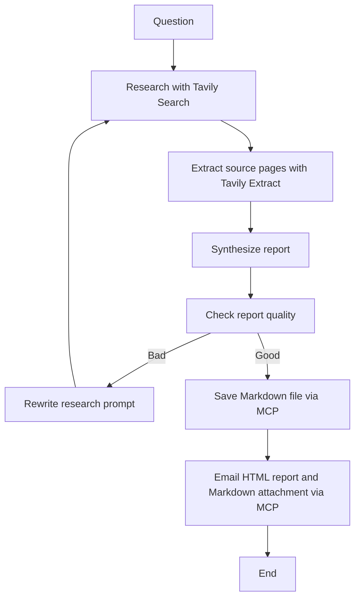

# Deep Research Agent

A local research agent built with LangGraph. It searches the web, extracts source pages, writes a cited report, checks its quality, saves it as Markdown, and emails it.

## Flow



The graph keeps the question, search results, report, and quality decision in its state. A bad quality decision sends the graph back to research with a revised prompt.

## Run locally

1. Install [UV](https://docs.astral.sh/uv/) and open a terminal in the project root.
2. Copy `.env.example` to `.env`. Replace the example values with your own keys and email address.
3. Install the locked dependencies:

   ```powershell
   uv sync
   ```

4. Set the question in `src/deep_research_agent/agent/agent.py`. The runner currently uses `"What is LangGraph?"`.
5. Run the agent:

   ```powershell
   uv run python -m deep_research_agent.agent.agent
   ```

The terminal shows the start and end of each node, followed by the report title, quality decision, and email status. The report is saved to `src/deep_research_agent/output/research_report.md`. The email contains a formatted HTML report and the Markdown file as an attachment.

## Environment variables

| Variable | Purpose |
| --- | --- |
| `OPENAI_API_KEY` | Generates the report and rewrites a weak research prompt. |
| `GOOGLE_API_KEY` | Checks report quality. |
| `TAVILY_API_KEY` | Searches for and extracts web pages. |
| `RESEND_API_KEY` | Sends the report email. |
| `RECEPIENT_EMAIL` | Receives the report. The spelling matches the current code. |
| `MAX_SEARCH_RESULTS` | Sets the number of Tavily search results. |
| `LANGSMITH_TRACING` | Set to `true` to record traces. |
| `LANGSMITH_API_KEY` | Authenticates with LangSmith. |
| `LANGSMITH_PROJECT` | Selects the LangSmith project. |
| `LANGSMITH_ENDPOINT` | Sets the LangSmith API endpoint. |

See `.env.example` for the expected values. Keep `.env` private.

## View traces

Set the LangSmith variables in `.env`, run the agent, then open the project named by `LANGSMITH_PROJECT` in LangSmith. Open the latest run to inspect each graph node and tool call. The email node records a failure event if Resend rejects the message.

## Current limits

- The question is hardcoded in the runner. There is no command-line input or frontend yet.
- There is no retry limit. A repeated bad quality decision can keep the graph in a loop.
- The graph uses an in-memory checkpointer. Saved state does not survive a process restart.
- Each successful run overwrites the same Markdown file.
- Search, extraction, and model errors stop the run. Email errors are recorded in the final state.

