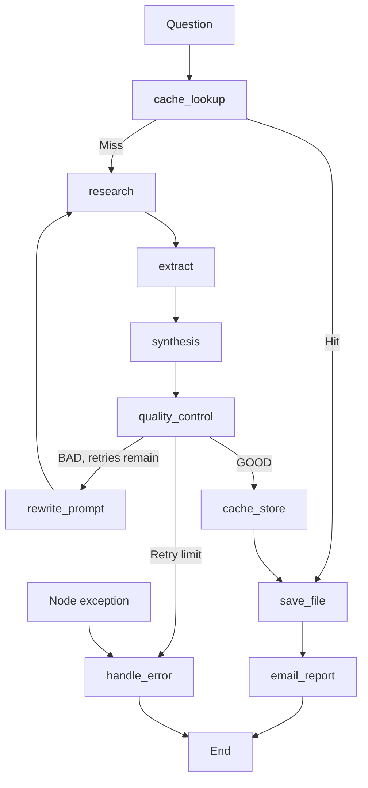

# Deep Research Agent

Deep Research Agent is a local command-line application built with LangGraph. It takes a question, searches the web, reads source pages, writes a cited Markdown report, checks its quality, saves it, and sends it by email. It can reuse a recent approved report for a similar question.

The project currently has no frontend, HTTP API, or deployment setup.

## Workflow



The graph starts with `original_question` and `research_prompt` set to the same text. The original question stays fixed. The research prompt can change after a failed quality check. Nodes share results through a typed state.

### Nodes

| Node | What it does |
| --- | --- |
| `cache_lookup` | Looks for a similar approved report in Redis before research. A hit loads the report into state. |
| `research` | Searches Tavily with the current research prompt and records each prompt tried. |
| `extract` | Extracts Markdown content from the URLs returned by Tavily Search. |
| `synthesis` | Gives the original question and sources to an OpenAI model. It requests a structured title and report body. |
| `quality_control` | Uses a Google decision model to mark the report `GOOD` or `BAD` for the original question. |
| `rewrite_prompt` | Improves the research prompt after a `BAD` decision and increments the retry count. |
| `cache_store` | Stores a `GOOD` report in Redis under the original question. |
| `save_file` | Calls the MCP `save_text` tool to write the approved report. |
| `email_report` | Calls the MCP `send_email` tool to send the approved report. |
| `handle_error` | Handles the quality retry limit and node exceptions. It sends a notice when possible and records delivery errors. |

The graph allows **three prompt rewrites**: one initial research pass and up to three more passes. If quality is still `BAD`, `handle_error` sends a notice with the original question and all search prompts tried. It does not save or attach that report.

## Design decisions

### Keep the question separate from the search prompt

The agent can change its search prompt to find better sources. It still writes and checks the report against the user's original question. This keeps each retry focused on the request.

### Check the cache before research

[`cache.py`](src/deep_research_agent/agent/utils/cache.py) uses `RedisSemanticCache` with OpenAI `text-embedding-3-small`. The library compares question meaning; the project does not implement its own similarity calculation. The distance threshold is `0.1`. Cached reports expire after `1800` seconds, or 30 minutes.

A hit skips search, extraction, synthesis, and quality control. It still embeds the new question, writes the Markdown file, and sends the email. Only reports marked `GOOD` enter the cache. A hit reuses that earlier quality decision. It does not check whether the report answers every detail of the new question.

The Redis index is named `deep-research-reports`. The cache uses `deep-research-report` as the stable identifier required by `RedisSemanticCache`. Entries can be reused across separate graph runs until they expire. Clear existing entries before relying on a new report rule, because cache hits skip quality control.

### Limit report length before the decision API

The synthesis prompt asks for a report body of at most **3,000 characters**, including Markdown, citations, and Sources. The quality node also counts the body with Python `len()`. If the body exceeds 3,000 characters, it marks the report `BAD` before calling the Google decision API. It does not truncate the report. The rewrite node receives the measured length and asks for a more focused search query. A report that remains too long after the retry limit goes to the error node.

### Use one local MCP server for file and email actions

[`mcp_server.py`](src/deep_research_agent/mcp_server.py) provides `save_text` and `send_email`. The FastMCP client imports the server in-process, so the local graph does not need a separate MCP server process.

`save_text` writes `src/deep_research_agent/output/research_report.md`. Each successful run replaces that file. `send_email` renders the Markdown as HTML through MarkdownIt and sends a Markdown attachment through Resend. It builds the attachment from the report content; it does not read the saved file. The error node reuses the email tool without an attachment.

### Use one error route

LangGraph node error handlers route node exceptions to `handle_error`. The quality retry limit also routes there. The state records the error source and message. If sending the report email fails, the error node records that failure and does not try to send a second email through the same path. If a failure notice cannot be sent, the node records a known MCP delivery error in `email_error`. An unexpected error inside `handle_error` still stops the run.

### Keep tracing and checkpoints separate from the cache

When enabled, LangSmith records the graph run and its nodes. The runner also prints node progress, total duration, the question, cache result, report title, quality decision, and email status.

The graph uses an `InMemorySaver` checkpointer and a new UUID thread ID for each command-line run. Checkpoints do not survive a process restart. Redis is separate and can hold cached reports across runs.

## Run locally

You need Python 3.12 or later, [uv](https://docs.astral.sh/uv/), Docker with Compose, and the API keys listed below.

1. Install dependencies from the project root:

   ```powershell
   uv sync
   ```

2. Copy [`.env.example`](.env.example) to `.env`. Add your keys and recipient email. Set `REDIS_URL=redis://localhost:6379` when Python runs on the host.

3. Start Redis with [`compose.yaml`](compose.yaml):

   ```powershell
   docker compose up -d
   ```

4. Set `question` in [`agent.py`](src/deep_research_agent/agent/agent.py). The runner does not accept a command-line question yet.

5. Run the graph:

   ```powershell
   uv run python -m deep_research_agent.agent.agent
   ```

On success, read `src/deep_research_agent/output/research_report.md` and check the recipient mailbox. The email contains formatted HTML and a `research_report.md` attachment. The terminal shows `Cache: hit` for a reused report and `Cache: stored` for a newly researched report.

### Environment variables

| Variable | Purpose |
| --- | --- |
| `OPENAI_API_KEY` | Report synthesis, prompt rewriting, and question embeddings. |
| `GOOGLE_API_KEY` | Report quality decision. |
| `TAVILY_API_KEY` | Web search and page extraction. |
| `RESEND_API_KEY` | Email delivery. |
| `RECEPIENT_EMAIL` | Email recipient. This spelling matches the current code. |
| `MAX_SEARCH_RESULTS` | Tavily results per research pass. |
| `REDIS_URL` | Redis connection for semantic caching. |
| `LANGSMITH_TRACING` | Set to `true` to record traces. |
| `LANGSMITH_API_KEY` | LangSmith authentication. |
| `LANGSMITH_PROJECT` | LangSmith project name. |
| `LANGSMITH_ENDPOINT` | LangSmith API endpoint. |

Keep `.env` private.

### Inspect Redis

Run these commands from the project root:

```powershell
docker compose exec redis redis-cli PING
docker compose exec redis redis-cli DBSIZE
docker compose exec redis redis-cli --scan
docker compose exec redis redis-cli FT._LIST
docker compose exec redis redis-cli FT.INFO deep-research-reports
```

`PING` should return `PONG`. `FT.INFO` shows the index's `num_docs` count. Entries expire after 30 minutes. The Compose file does not mount a Redis volume, so recreating the container can remove its cache data.

## Observed cache results

Four local runs on 27 November 2026 showed two new reports and two cache hits. LangSmith recorded:

| Question | Cache | Latency | Tokens shown | Cost shown |
| --- | --- | ---: | ---: | ---: |
| What is LangGraph? | Stored | 21.55 s | 95.08K | $0.01375 |
| What is LangGraph in simple terms? | Hit | 5.70 s | None | None |
| What is LangGraph used for? | Hit | 6.06 s | None | None |
| How do I install LangGraph? | Stored | 23.65 s | 87.71K | $0.01133 |

The research runs averaged **22.60 seconds**. The hits averaged **5.88 seconds**. In this small sample, a hit took **16.72 seconds less**, a **74% reduction in elapsed time**. These runs do not establish a general performance rate.

The research runs showed **182.79K tokens** and **$0.02508** combined in LangSmith. The hit rows showed no token or cost values. That does not prove hits are free: each hit still embeds its question and sends an email. The table does not separate all provider charges. Use provider billing data to measure monetary savings.

## Current limits

- The question is set in code. There is no command-line question input or frontend.
- The checkpointer is in memory, and local Redis has no mounted volume.
- Every successful run overwrites the previous `research_report.md`.
- A cache hit does not rerun the quality check for the new question.
- An unexpected failure inside `handle_error` stops the graph.

